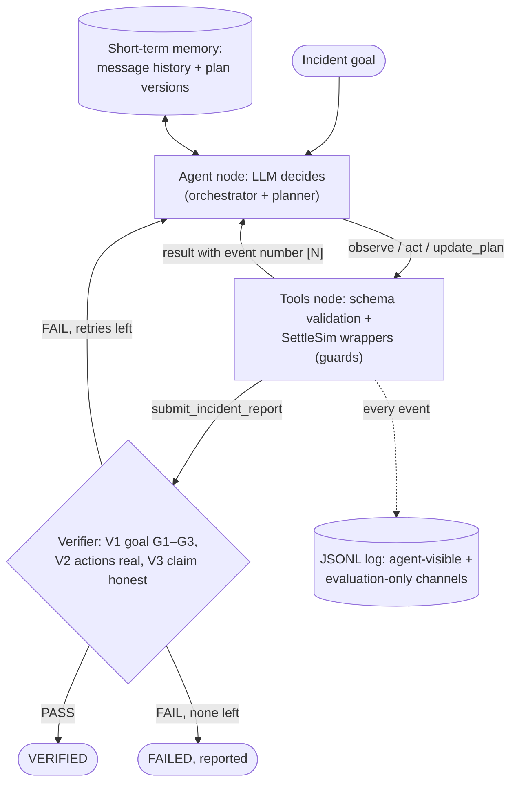
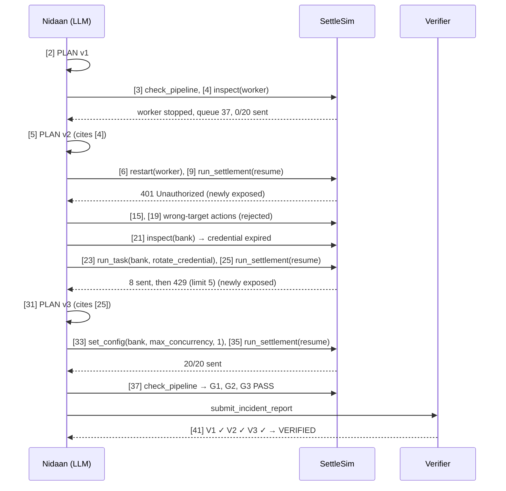
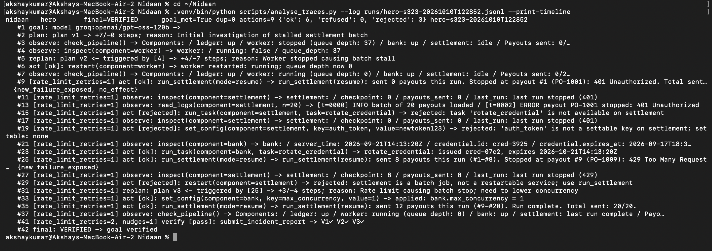
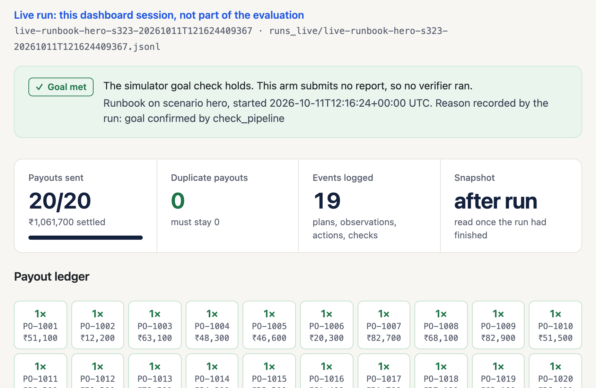

<div class="cover">
<div class="bar"></div>

<p class="task">Internal Assessment Task II – <b>Agentic AI System using Modern LLM-based Tools</b></p>
<p class="topic">“Nidaan: An LLM Agent for Autonomous Incident Response, Evaluated in a Controlled Payment-Settlement Environment”</p>
<p class="by">by</p>
<p class="names"><b class="rn">Roll No: 16015024005</b> <b>Akshay Ashwin</b><br><b class="rn">Roll No: 16015024007</b> <b>Saanvi Baraskar</b><br><b class="rn">Roll No: 16015024016</b> <b>Ameya Deore</b></p>
<p class="by">For the subject</p>
<p class="subject">Artificial Intelligence</p>
<p class="dept">Department of Electronics &amp; Computer Engineering<br>Academic Year 2026-27</p>
</div>

<div class="pb"></div>

# Nidaan – An LLM Agent for Autonomous Incident Response

<p class="note">Group of 3: only to be made in same lab batch</p>
<p class="note">Demo will be taken in lab duration</p>

<h2 class="label">Introduction, Abstract of problem statement</h2>

When a payment-settlement batch stalls, an on-call engineer must find *why* (often several causes at once), fix each cause safely, and finish the batch **without paying any merchant twice**. Some causes are hidden behind others: a credential problem appears only after a stopped worker is restarted, and a bank rate limit appears only once payouts start flowing. A fixed runbook handles only the causes its authors anticipated, and a plan made once at the start cannot react to problems that appear after acting.

**Nidaan** is an LLM agent that receives this goal, plans, uses tools to observe and act on a simulated settlement system (*SettleSim*), revises its plan when new failures appear, and finishes with an incident report that a deterministic verifier checks. It follows the workflow in the instructions — *Goal → Plan → Tool Use → Observation → Next Action → Final Output* — and every step is logged. We compare it with a classical rule-based agent (a runbook) and with a single-step LLM planner. All numbers are measured from stored logs (`runs/*.jsonl`) and results files (`results/*.json`) produced on 2026-10-10; samples are very small (one run per arm, scenario and prompt version), so results are indicative only.

**AI framework(s) used:** **LangChain** (chat-model and tool interfaces) and **LangGraph** (the agent loop as a state graph), implementing a **ReAct-style** reasoning–action–observation loop [1–3]; the LLM is served through the free tier of the **Groq API** [4]. Python 3.13; pytest for tests.

**Tools integrated with agent:** ten Python tools exposed to the LLM through LangChain `StructuredTool` schemas (Section B.2): four *observe* tools, four *act* tools, and two *control* tools (planning and final report). They are custom Python tools over a simulated environment — the instructions' "Python tools" category.

## Part A – Agent Design (Modern View)

**Goal of the agent.** The agent receives, verbatim: *"Incident: today's payout settlement batch has not completed. Restore the pipeline so that every payout in the batch is settled exactly once and all components are healthy, then submit an incident report."* Success is checked mechanically by three invariants: **G1** worker running and queue empty, **G2** ledger up, **G3** every payout sent exactly once.

**Agent role.** Autonomous on-call incident responder for one simulated pipeline. It decides what to observe, which component to change and with which value, when to replan, and when to stop. It does not change the environment's rules: SettleSim applies actions and enforces safety guards, and a deterministic verifier — not the LLM — decides whether the goal was met.

**Environment (SettleSim).** One deterministic Python object with four components (ledger, worker, bank gateway, settlement batch of 20 payouts). A settlement run checks each payout in a fixed order — ledger writable, authentication valid, endpoint correct, within rate limit — and stops at the first failure, so later faults stay hidden until earlier ones are fixed. Faults are conditions on state, generated from a seed; five development fault types are implemented:

| Fault | First visible symptom | Distinguishing evidence | Fix (value from observation) |
|---|---|---|---|
| F1 credential expired | 401 on settlement | `inspect(bank)`: expiry < server time | `run_task(bank, rotate_credential)` |
| F2 stale signing key | the same 401 | `inspect(bank)`: key in use ≠ vault key | `set_config(bank, key_in_use, <observed key>)` |
| F4 disk full | write errors; settlement refused | `inspect(ledger)` | `run_task(ledger, rotate_logs)` |
| F6 worker stopped | "N payments unconfirmed" | `inspect(worker)` | `restart(worker)` |
| F7 rate limit (latent) | nothing until payouts flow | 429 with the limit | `set_config(bank, max_concurrency, ≤ limit)` |

Safety: a ledger restart is *refused* while the disk is full or sessions are active; settlement is refused while the ledger is incomplete; duplicate payouts are *measured, not blocked* — `run_settlement(full)` after a partial run sends payouts twice, which fails the goal. Three further fault types are reserved for a sealed held-out evaluation and are not exposed to the agent.

**Tools used.** Ten tools in three groups — observe, act and control — listed with their behaviour in B.2.

**Memory type (short-term / context).** Short-term, within-run memory only:

1. the **message history** held in the LangGraph state (`messages` with the `add_messages` reducer in `nidaan/graph.py`) — system prompt, goal, every model reply and every tool result, resent to the LLM on each call; and
2. the **plan history** (`PlanManager` in `nidaan/plan.py`): each accepted plan version, its steps and the event numbers it cited.

Every tool result is prefixed with an event number `[N]`, so the agent can refer back to earlier observations. There is **no persistent memory**: one incident is one run, and nothing carries over between runs.

**Planning strategy (ReAct / step-by-step).** ReAct-style interleaving of plan, tool call and observation [1], with a **validated plan**. The agent must call `update_plan` before any observe/act call; every later plan must cite, in `triggered_by`, existing event numbers including at least one newer than the previous plan, and must change the step list (no-op replans are rejected). The prompt asks the agent to replan whenever an action is rejected, has no effect, or exposes a new failure; measured adherence is low (Discussion). Hidden reasoning is neither displayed nor stored; the observable reasoning is the plan, its stated reason, and a one-sentence `why` (≤ 25 words) on every tool call.

## Part B – Implementation (Modern AI Tools)

### B.1 LLM-based agent

| Item | Choice and justification |
|---|---|
| LLM | `openai/gpt-oss-120b` [5] on Groq, temperature 0, reasoning effort *low*, reasoning text not returned (`nidaan/llm.py`, `config.py`) |
| Why this LLM | Free tier, production (non-preview) model with tool calling; a one-call compatibility check on 2026-10-10 showed Groq accepted all ten tool schemas, including the nested report schema |
| Why not the original choice | Gemini Flash was used first, but its free tier allowed 20 requests/day for the model; none of six hero attempts on 2026-10-08 completed (5 quota errors, 1 interrupted). Switching to Groq is a documented deviation from our specification |
| Free-tier limits (Groq console) | 30 requests/min, 1,000 requests/day, **8,000 tokens/min, 200,000 tokens/day** |
| Loop limits | 30 LLM steps per run; 2 "nudges" if the model replies without a tool call; 2 verifier retries; rate-limit responses retried after the server-stated delay. After the measured runs, provider errors are classified (per-minute limit, daily quota, outage, fatal) with separate retry budgets, a total-wait cap and tokens-per-minute pacing; this is tested offline only |

### B.2 Tools used

| Tool | Kind | What it does | Can fail? |
|---|---|---|---|
| `check_pipeline` | observe | component status, queue depth, payouts sent, goal invariants G1–G3 | no |
| `inspect(component)` | observe | configuration and metric fields of one component | no |
| `read_logs(component, grep?, n≤30)` | observe | recent log lines | no |
| `get_batch_status` | observe | sent/pending, checkpoint, any payout sent twice | no |
| `restart(component)` | act | restart a component | refused by safety guard |
| `set_config(component, key, value)` | act | change one setting; unknown keys are rejected with the list of settable keys | rejected |
| `run_task(component, task)` | act | one of four maintenance tasks | rejected / no effect |
| `run_settlement(mode)`, mode = `resume` or `full` | act | run the batch from the checkpoint or from payout 1 | refused; may duplicate |
| `update_plan(steps, reason, triggered_by)` | control | record or revise the plan (validated) | rejected if invalid |
| `submit_incident_report(...)` | control | root causes, actions performed, summary → verifier | — |

*Justification and features.* Observe/act separation makes "evidence before action" visible in the trace. Arguments are validated by Pydantic schemas before execution; invalid targets are *rejected* (not executed) and unsafe requests are *refused* by SettleSim. Configuration values such as a signing key or a rate limit appear only in tool results, never in the prompt, so the agent must find them by observing.

### B.3 Multi-step reasoning — architecture diagram

The three layers are explicit: the LLM **decides**, SettleSim **changes state and enforces safety**, and the verifier **checks**. Mapped to the reference architecture in the instructions: *Orchestrator Agent (LLM)* = the `agent` node; *Planner* = `update_plan` with plan validation; *Memory* = message history + plan history; *Tool APIs* = the eight SettleSim tools; *Final Output* = the verified incident report.



### B.4 Multi-step reasoning — tool flow diagram (hero, original prompt)

Verified run `hero-s323-20261010T122852`; event numbers are from the log; some observe calls are omitted.



### B.5 Observable agent behavior (logs / traces)

**Code repository / notebook.** Repository: https://github.com/akshay-ashwin/Nidaan-Agentic-Incident-Response. Python ≈3,000 lines for the agent, environment, baselines and evaluation, ≈1,900 for the dashboard and ≈2,900 lines of tests: `settlesim/` (environment, generator, tool wrappers), `nidaan/` (graph, prompt, tools/executor, plan validation, verifier, logger, model factory, LLM error handling, provenance), `baselines/` (runbook, one-shot), `evaluation/` (metrics, Wilson intervals, aggregation, harness, trace analysis), `scripts/` (evaluation driver, trace analyser), `ui/` (Streamlit dashboard). **360 offline tests pass**, covering the simulator, the hero solved by hand through the tool wrappers, plan validation, the verifier, the no-leak test, metrics, provenance, LLM error classification and retry limits, and the dashboard. They make no LLM calls and do not show that the live agent succeeds; agent behaviour is evidenced only by the runs in Part C.

**Dashboard.** `streamlit run ui/app.py` opens five sections: *Overview* (recorded results with Wilson intervals), *Investigate & Run* (a development scenario's starting state), *Live Execution*, *Recovery Verification* (the agent's report, the verifier and the simulator's goal check side by side) and *Trace & Evaluation* (all metric tables, traces and JSONL downloads). Loading or navigating starts nothing. **Run Runbook** starts a live runbook run (no model calls); **Run Nidaan** starts a live agent run and is enabled only with an API key and a ticked quota confirmation. Live runs are logged to `runs_live/` and are excluded from every metric in this report; held-out scenarios cannot be selected. The dashboard is a viewer and launcher: it does not change the agent, the verifier or any result. A command-line run is `python run.py --scenario hero` (uses API quota); demo commands are in `docs/SUBMISSION_CHECKLIST.md`.

**Agent interaction logs.** Every run writes `runs/<run_id>.jsonl` with seven event types (GOAL, PLAN, OBSERVE, ACT, VERIFY, FINAL, ERROR). Each event carries what the agent saw (`result`), the agent's stated `why`, the outcome (ok / refused / rejected), and per-call latency and token counts. Evaluation-only annotations (e.g. whether an action exposed a new failure) are stored in a separate field that is never shown to the agent. New runs also record a provenance block (prompt and code SHA-256, git commit and dirty state, provider, model); of the runs reported here, only the revision-2 hero run has it. Excerpt from the verified hero run with the original prompt (verbatim values; selected events and fields; long results shortened with "…"):

```text
{"seq":2,"type":"PLAN","plan_version":1,"steps":["Check overall pipeline status and batch progress", … 7 steps],"reason":"Initial investigation of stalled settlement batch","result":"plan v1 accepted","tokens":{"total":1414}}
{"seq":9,"type":"ACT","tool":"run_settlement","args":{"mode":"resume"},"why":"Attempt to process pending payouts","result":"… Stopped at payout #1 (PO-1001): 401 Unauthorized. Total sent: 0/20.","outcome":"ok"}
{"seq":21,"type":"OBSERVE","tool":"inspect","args":{"component":"bank"},"why":"Check bank auth config","result":"bank: / server_time: 2026-09-21T14:13:20Z / … credential.expires_at: 2026-09-17T18:35:52Z / …"}
{"seq":25,"type":"ACT","tool":"run_settlement","args":{"mode":"resume"},"why":"Retry after rotating bank credentials","result":"… sent 8 payouts this run (#1-#8). Stopped at payout #9 (PO-1009): 429 Too Many Requests (X-RateLimit-Limit: 5). …"}
{"seq":31,"type":"PLAN","plan_version":3,"triggered_by":[25],"reason":"Rate limit causing batch stop; need to lower concurrency","steps":["Set bank max_concurrency to 1","Retry settlement batch resume","If still fails, consider full run"]}
{"seq":35,"type":"ACT","tool":"run_settlement","args":{"mode":"resume"},"result":"… sent 12 payouts this run (#9-#20). Run complete. Total sent: 20/20."}
{"seq":41,"type":"VERIFY","result":"verification PASSED","outcome":"pass","checks":{"V1":true,"V2":true,"V3":true}}
```

**Prompts and output screenshots.** The goal text is quoted in Part A. The current system prompt (`nidaan/prompt.py`, revision 2, SHA-256 `812cea17…`) is reproduced verbatim:

```text
You are an incident-response agent operating a small payment-settlement system through tools. Each run is one incident. Work autonomously until the goal is verified.

Principles:
- Assess the situation before acting. Start by writing a plan with update_plan; no observe or act call is accepted before a plan exists.
- Collect evidence that distinguishes between competing explanations before choosing a fix.
- Take configuration keys and values from observations; never guess them. Use only a key you have seen for that component, and when a result lists which keys, tasks or targets are valid, use that list instead of guessing.
- Inspect state before any operation that cannot be undone, and check that its effects will be safe.
- Prefer minimal, reversible changes.
- Fixing one problem can expose another. If an action is rejected, does not produce the expected effect, or reveals a failure you did not anticipate, treat that result as the trigger for your next decision: reassess your hypothesis and call update_plan with a changed step list, citing in triggered_by the event numbers of the results that prompted it, before continuing with further evidence-gathering or actions. Then gather evidence under the revised plan.
- A rejected action changed nothing. Read its message, and do not try different guesses against the same component without relevant new evidence. Replan from fresh observations; do not repeat an action that already failed without new evidence.
- After an action that may have resolved a problem, obtain a fresh observation to check the current state. Before retrying an operation with side effects, inspect its status and determine whether retrying is safe. Then resume the required operation if appropriate and confirm the overall goal using check_pipeline. Historical logs alone do not prove that a recovery attempt succeeded.
- Stop only when check_pipeline confirms the goal. Never claim success you have not observed.
- Report only actions you actually performed.

Mechanics:
- Make one tool call at a time and read its result before deciding the next step.
- Every observe and act call needs a 'why': one sentence of at most 25 words.
- Every tool result begins with an event number in brackets, e.g. [7]. Use these numbers for triggered_by in update_plan, and for evidence and actions in the report.
- When finished, call submit_incident_report. 'actions' lists the event numbers of the act calls you performed. If verification fails you will be told which checks failed and may continue repairing.
- Production systems must enforce payout uniqueness with idempotency keys; here, you are responsible for reasoning about whether any step could send a payout more than once.
```

The measured runs used earlier versions: the **original** prompt (`9a07d0d0…`, in the first git commit) and **revision 1** (`52800b31…`). Revision 1 added the configuration-grounding, rejected-action and post-fix verification principles; revision 2 changed one clause so that replanning after a failure is unconditional. After the revision-2 hero run, descriptions were added to the report fields (`root_causes`, `component`, `description`) to say that a root cause names the component whose own state was faulty, not where the symptom appeared, and that corrected problems are included; the prompt was not changed. A test asserts that the system prompt, goal and nudge texts and all 31 tool and field descriptions (34 texts) contain no held-out fault terms or scenario values. The one-shot baseline's prompt is in `baselines/oneshot.py`.

Figure S1 is a terminal capture of a recorded run. Figures S2 and S3 were captured from the current dashboard on 2026-10-11: S2 shows a recorded run; S3 shows a live Runbook run, which makes no model calls and is not evaluation evidence.




*Transcription of the event shown in Figure S2 (verbatim from the run log; shortened with "…"):* `#37 VERIFY · verification PASSED · checks V1 ✓ V2 ✓ V3 ✓ · status_claimed: resolved · root_causes: settlement ("…expired bank credential causing 401 Unauthorized errors.", evidence 13, 19, 15), bank ("…rate‑limit exceeded after credential refresh, leading to 429 Too Many Requests.", evidence 25, 23) · actions: 7, 13, 23, 25, 29, 31`. As discussed below, the first root cause names the wrong component.



## Part C – Analysis & Comparison

### C.1 Classical agent vs modern agent

The **classical agent** is a deterministic runbook (`baselines/runbook.py`), a simple reflex agent in the sense of [7] (condition–action rules applied to the current percept), run in a loop: up to 20 iterations of *check_pipeline → first failing stage → read_logs + inspect → ordered condition–action rules → act*. It covers all five development faults in any combination and is deliberately strong (it always checks batch status and resumes from a checkpoint). A second baseline, **one-shot LLM**, uses the same model but is called once on a full snapshot (pipeline status, all components, all logs) and its action list is executed blindly.

| Instruction criterion | Classical agent (runbook) | Modern agent (Nidaan) | Evidence |
|---|---|---|---|
| Rule-based vs LLM-driven | Hand-written condition–action rules; no LLM | LLM chooses each tool call and its arguments | `baselines/runbook.py`; `nidaan/graph.py` |
| Static logic vs dynamic planning | Fixed rule order; cannot handle a fault it has no rule for | Writes, cites and revises plans when results change (e.g. PLAN v3 triggered by the 429 at #25) | hero log #2, #5, #31 |
| No memory vs contextual memory | Keeps no state between loops; re-reads the pipeline each loop | Whole within-run history and plan versions in context | `nidaan/graph.py`, `nidaan/plan.py` |
| Single-step vs multi-step reasoning | The runbook loops, so it is not single-step; our **one-shot LLM** baseline is the single-step case (one call, no observation after acting) | 23 LLM calls and 18 tool calls interleaved with observations in the hero run | `results/*.json`, hero log |


### C.2 Methodology

Six fixed development scenarios (seed; faults): hero (323; F6+F1+F7), dev_f2 (11; F2), dev_f4 (12; F4), dev_f7 (13; F7), dev_f1_f2 (14; F1+F2), dev_f4_f6 (15; F4+F6). Metrics are computed automatically from the logs: goal success, duplicate payouts, refused and harmful actions, unnecessary actions (executed but no effect), **appropriate replanning** (an accepted plan within 2 steps after an action that failed or exposed a new problem), and **batch status checked before every settlement run**; proportions carry Wilson 95 % confidence intervals [6].

**Performed on 2026-10-10:** runbook ×1 and one-shot ×1 on all six scenarios; Nidaan ×1 on hero and dev_f2 with the original prompt, ×1 on dev_f2 with revision 1, and ×1 on hero with revision 2 (the first run with recorded provenance). **Not performed (missing, not failed):** Nidaan on dev_f4, dev_f7, dev_f1_f2 and dev_f4_f6; dev_f2 with revision 2; any evaluation run with the added report-field descriptions; the planned 10-run hero rehearsal (≥ 9 successes required); the held-out evaluation, which remains sealed. One Nidaan run used 46,000–78,000 tokens. Local token totals did not predict Groq's daily limit: four Nidaan runs totalling 232,811 tokens completed on 2026-10-10 and met only the per-minute limit, so remaining capacity has to be checked in the Groq console before each run.

**Live dashboard demonstration (not evaluation evidence).** On 2026-10-11 one Nidaan run of the hero scenario was started from the dashboard (`runs_live/live-nidaan-hero-s323-20261011T103723679527.jsonl`), with prompt revision 2 and the added report-field descriptions (code SHA-256 `fec60091…`, uncommitted working tree). It was VERIFIED (V1–V3), with 0 duplicate payouts, 6 actions, 17 LLM calls, 38,110 tokens and 215 s wall-clock; 14 rate-limit responses were retried. Its report named the correct root-cause components (worker, bank). Appropriate replanning was 0/2, and batch status was checked before 1 of 3 settlement runs. It is a single live run, outside the evaluation protocol and excluded from Tables 1–2, so it says nothing about reliability and cannot be attributed to the field descriptions.

### C.3 Results (measured)

**Table 1 — Goal success and safety by arm (one run each; Nidaan reported per prompt version, never pooled).**

| Arm | Runs | Goal success (Wilson 95 % CI) | Duplicates | Refused | Harmful | Batch status checked before settling |
|---|---|---|---|---|---|---|
| Runbook (classical) | 6 | **6/6** (0.61–1.00) | 0 | 0 | 0 | 11/11 settlement runs |
| One-shot LLM | 6 | **1/6** (0.03–0.56) — dev_f4 only | 0 | 2 | 0 | 0/6 |
| Nidaan, original prompt | 2 | **1/2** (0.09–0.91) — hero ✓, dev_f2 ✗ | 0 | 0 | 0 | 1/6 |
| Nidaan, revision 1 | 1 | **1/1** (0.21–1.00) — dev_f2 ✓ | 0 | 0 | 0 | 0/4 |
| Nidaan, revision 2 | 1 | **1/1** (0.21–1.00) — hero ✓ | 0 | 0 | 0 | 1/3 |

**Table 2 — Per-run detail on the two scenarios Nidaan ran.**

| Scenario · arm | Outcome | Payouts | Actions (ok/rej/ref) | Unnec. | Replanning | LLM calls | Tokens | LLM time | Wall-clock |
|---|---|---|---|---|---|---|---|---|---|
| hero · Nidaan | VERIFIED (V1–V3 ✓) | 20/20 | 9 (6/3/0) | 1 | 0/2 | 23 | 52,492 | 18.0 s | 244 s |
| hero · runbook | goal met | 20/20 | 6 (6/0/0) | 1 | n/a | 0 | — | — | < 0.1 s |
| hero · one-shot | goal not met | 8/20 | 3 (3/0/0) | 0 | n/a | 1 | 775 | 0.95 s | 1.0 s |
| dev_f2 · Nidaan | FAILED (30-step limit) | 0/20 | 13 (6/7/0) | 5 | 3/5 | 30 | 77,715 | 25.7 s | 319 s |
| dev_f2 · Nidaan rev. 1 | VERIFIED (V1–V3 ✓) | 20/20 | 10 (6/4/0) | 4 | 0/4 | 23 | 56,709 | 19.1 s | 565 s |
| hero · Nidaan rev. 2 | VERIFIED (V1–V3 ✓) | 20/20 | 7 (6/1/0) | 1 | 0/2 | 20 | 45,895 | 14.5 s | 220 s |
| dev_f2 · runbook | goal met | 20/20 | 3 (3/0/0) | 1 | n/a | 0 | — | — | < 0.1 s |
| dev_f2 · one-shot | goal not met | 0/20 | 1 (1/0/0) | 1 | n/a | 1 | 665 | 0.69 s | 0.8 s |

In the four Nidaan runs, 17, 24, 19 and 16 rate-limit responses (8,000 tokens/min) were retried internally; none became a failed agent step, but waiting dominated wall-clock time (226 of the hero's 244 s were spent outside successful LLM calls). Each Nidaan call averaged 2,300–2,600 tokens because the full history is resent.

### C.4 What the comparison shows

- **Known faults: the classical agent wins.** The runbook solved 6/6 with fewer actions, no rejected actions, every settlement preceded by a batch-status check, and no LLM cost. When failure modes are enumerated in advance, explicit rules are cheaper, faster and safer.
- **Single-step LLM planning fails when information appears only after acting.** The one-shot baseline failed 5/6: the rate limit is visible only once payouts flow (hero, dev_f7: 429 after 8 and 6 payouts); it did not fix the stale key (dev_f2, dev_f1_f2); in dev_f4_f6 it restarted the worker before freeing disk, so settlement was refused.
- **The multi-step agent can react.** Nidaan completed the three-fault hero that the one-shot could not, by acting, observing the newly exposed 401 and 429, and adjusting — at about 68× the one-shot's tokens on that scenario (52,492 vs 775) and with 3 rejected actions.
- **No generalisation claim.** The case for an LLM agent over a runbook — faults no rule anticipates — is the subject of the held-out evaluation, which has not been run.

<h2 class="center ital">Discussion, takeaway</h2>

**Failure cases with the original prompt.**

1. *Configuration not grounded in observations.* Hero #19 set `auth_token=newtoken123` on the settlement component; neither the key nor the value had been observed. All such actions were rejected by SettleSim, but they used steps.
2. *Slow replanning.* In the hero, the 401 (#9) was followed by a replan only at #31 (appropriate replanning 0/2). In the original dev_f2 run, 7 of 13 actions were rejected, including three different task guesses against the same wrong component.
3. *No verification after a fix.* In the original dev_f2 run, `restart(bank)` at #39 cleared the fault (the stated reason was a different hypothesis). In the remaining six steps the agent never re-ran settlement or `check_pipeline`, re-read old logs, and hit the 30-step limit. A deterministic replay of these actions plus one safe continuation reaches 20/20 and passes the verifier — an environment check, not evidence about the model.

**Prompt revision 1 on dev_f2 (one run).** Verified, 20/20, 0 duplicates. The fix came from an observed value (`key_in_use` set to the `vault_active_key` shown by `inspect(bank)`) and was followed by settlement and `check_pipeline`. But appropriate replanning was 0/4, batch status was checked before 0/4 settlements, and `full` settlement was used three times — harmless only because 0 payouts had been sent, which the agent had observed but never stated as a reason. Its report also blamed an expired credential, which its own cited evidence contradicts (expiry 2026-10-19 vs server time 2026-09-21), and omitted three settlements it performed from the action list. The verifier does not judge root causes by design, so it passed. **With one run per prompt, we cannot attribute the change from failure to success to the revision.**

**Prompt revision 2 on the hero (one run).** Verified, 20/20, 0 duplicates, and after the partial run it resumed rather than restarting the batch. It used fewer actions (7, one rejected guess) and tokens (45,895) than the original hero run, and its report listed all six executed actions. But it did not replan after the 401 or the 429 (0/2), and its root causes named the wrong components: the expired credential was attributed to the settlement component, where the 401 appeared, and the stopped worker it had fixed was not listed (root-cause component accuracy false). Across all four Nidaan runs an accepted plan followed only 3 of 13 failures within two steps; two prompt revisions did not change this, and enforcing replanning in code would change the frozen plan-validation rules, so it remains a reported limitation.

**Takeaways.**

- Separating *decide* (LLM), *act and enforce* (SettleSim) and *check* (verifier) made every failure diagnosable to an exact event and kept unsafe or invalid actions from changing state.
- A successful outcome is not proof of good reasoning: dev_f2 was once fixed incidentally, and a verified report contained a wrong explanation. The trace, not the success flag, is the evidence.
- Free-tier quotas dominated the project: the first provider could not complete one run, and the second throttled every agent run at 8,000 tokens per minute, so waiting dominated wall-clock time.

<h2 class="center"><i>Nidaan</i> - Conclusion</h2>

Nidaan meets the activity's requirements: one LLM-based agent (gpt-oss-120b via Groq) orchestrated with LangChain/LangGraph, ten tools, multi-step ReAct-style reasoning with validated replanning, short-term contextual memory, and fully observable behaviour through JSONL traces. It completed the three-fault hero incident end-to-end, with a verified report and zero duplicate payouts, in both hero runs (original prompt and revision 2). On the evidence collected so far, the classical runbook is best on known faults, a single-step LLM plan fails when key information appears only after acting, and the multi-step agent handles that interaction but is costly and makes avoidable mistakes. Evaluation is incomplete: Nidaan has run on two of six development scenarios, only once with the current prompt in the evaluation, not yet in an evaluation run with the added report-field descriptions (one live dashboard demonstration used them), and the held-out evaluation has not started.

**Remaining work, in order:** (1) Nidaan on all six development scenarios with the current configuration (revision-2 prompt + report-field descriptions); (2) hero rehearsals (≥ 9 successes in 10); (3) freeze the prompt and configuration; (4) held-out evaluation in a separate, explicitly started session; (5) final technical report.

<h2 class="center">References</h2>

1. S. Yao, J. Zhao, D. Yu, N. Du, I. Shafran, K. Narasimhan, Y. Cao. *ReAct: Synergizing Reasoning and Acting in Language Models.* ICLR 2023.
2. LangChain documentation. https://python.langchain.com/
3. LangGraph documentation. https://langchain-ai.github.io/langgraph/
4. Groq documentation: models, tool use, rate limits. https://console.groq.com/docs
5. OpenAI. *gpt-oss-120b & gpt-oss-20b Model Card*, 2025.
6. E. B. Wilson. *Probable inference, the law of succession, and statistical inference.* Journal of the American Statistical Association 22(158):209–212, 1927.
7. S. Russell, P. Norvig. *Artificial Intelligence: A Modern Approach*, 4th ed. Pearson, 2020.
